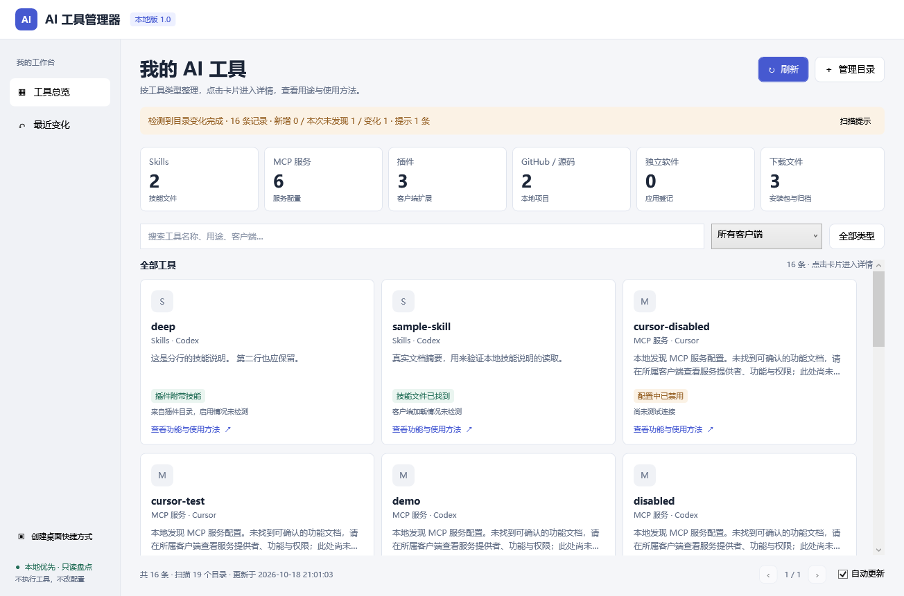

# AI工具管理器 · Windows 本地版 1.0.0

这是按已确认的“卡片工具库 → 独立功能详情页 → 返回工具库”界面实现的原生桌面程序。界面使用真实扫描结果，不再使用 Demo 数据。无需 VS Code、Node.js、Python 或 .NET SDK。

## 项目文档

- [产品设计说明书](docs/产品设计说明书.md)
- [技术说明书](docs/技术说明书.md)
- [测试与验收说明](docs/测试与验收说明.md)
- [1.0 版本说明](docs/发布说明-v1.0.0.md)
- [界面原型](design/prototype.html)（需下载后在浏览器打开；与桌面程序分开）
- [更新记录](CHANGELOG.md)

## 开始使用

1. 解压完整压缩包，将 **AI工具管理器.exe** 放到准备长期保留的文件夹。
2. 双击 EXE。首次打开会自动盘点常见客户端目录、下载目录及当前上下文中的 Windows 应用登记。
3. 如需从桌面打开，点击左下角 **创建桌面快捷方式**。这一步由你主动操作，不会自动安装程序或创建其他入口。移动 EXE 后请重新创建快捷方式。
4. 在右上角 **管理目录** 中添加自己的工具、下载或项目目录。自选目录与自动更新开关会保存在 EXE 旁的 Data/settings.json，重启后保留；请将程序放在有写入权限的目录。
5. 点击卡片进入功能说明、使用方法与“本地位置”。返回会保留搜索、客户端筛选和所在页。

EXE 已内嵌界面与扫描模块，可以单独运行。src、tools 和 tests 用于查看源码、构建及验证，不是运行依赖。目标系统为 Windows 10/11（系统 WPF/.NET Framework 与 Windows PowerShell 5.1 组件）。在当前 Windows 11 环境完成实测，未在另一台 Windows 10 设备实测；组织策略可能限制应用运行。程序尚未做数字签名。

## 刷新与自动更新

- **刷新**：重新读取本轮目录、配置、文档和应用登记，更新清单。扫描期间可取消；取消保留上次完整清单。
- **自动更新**：软件打开且开关启用时，监听纳入范围的目录。文件变化稳定约 1.4 秒后重新盘点；另每 60 秒补充核对一次应用登记等变化。软件关闭时不运行，不注册后台服务或开机启动任务。
- **最近变化**：记录本次会话的新发现、资料/状态变化和“本次未再发现”。后者也可能是权限或位置变化，不等于工具管家删除了文件。
- 只会发现扫描范围内的文件。下载到其他磁盘或自定义目录，请先从“管理目录”添加。
- 工具库每页显示 30 条，避免大量卡片影响桌面响应；分类计数与搜索针对全部扫描结果。

## 状态与说明

首页按 Skills、MCP 服务、插件、GitHub/源码、独立软件和下载文件统计。状态说明具体发现的证据：例如“技能文件已找到”“已写入客户端配置”“配置中已禁用”“系统中有安装记录”“安装包已下载”。不再将不同情况统称为“待验证”。

文件存在、配置存在和客户端实际加载/连接成功是不同的事情。卡片下方和详情页会说明哪些运行情况尚未检测。插件缓存、配置示例、普通编辑器扩展、Git 项目和下载文件也可能与 AI 无关，不会自动判为可用 AI 工具。

功能说明优先来自本地 SKILL.md 的 description、插件清单的 description，或项目 README 的摘要；使用说明提取自文档的 Usage/使用/快速开始段落，并显示来源。简单 YAML 标量和折行描述可以提取；复杂 YAML 不会执行解析表达式。

**缺少说明时提供类型层面的操作引导，明确说明没有找到可确认的具体功能文档。不会按名称编造每个 MCP 服务的功能。** 部分常见软件提供内置类型简介。原始文档可在程序内以纯文本阅读，其中的命令不会被执行。

## 扫描范围与边界

默认用户目录：

- .codex：深度 10；.claude：8；.agents：5；.cursor：4；.windsurf：4。
- .vscode/extensions：深度 1，扩展不一定与 AI 有关。
- Downloads：深度 3；在可读取当前用户下载目录设置时，采用重定向后的路径。
- source/repos：深度 3。
- 自选目录：深度 6。每轮总计最多 15000 个目录。

同时读取 Codex config.toml、Claude Code .claude.json 与 settings.json、Claude Desktop、Cursor、Windsurf、VS Code 常见 MCP 配置路径。项目中的 .mcp.json/mcp.json 也会列出，非标准位置的附带配置或示例会明确区分。JSON 配置支持常见注释与尾逗号。TOML 支持常用的 mcp_servers 服务表和 enabled/disabled 布尔标记，不是通用 TOML 解析器；特殊表语法可能跳过并提示。

源码工具识别 .git，或在下载/自选目录中识别同时存在 README.md 与项目清单的文件夹。GitHub 主页仅从匹配的远程地址中提取 owner/repo，不访问远程，也不保留凭据。

应用识别 Windows 卸载登记、当前用户 Appx 包以及常见命令入口。名称匹配不是所有 AI 应用的完整目录；PATH 入口存在也不保证依赖完整。WSL、其他 Windows 用户、远端环境、浏览器扩展及任意压缩包内部暂不解析。

不跟随目录连接点/链接，跳过依赖、构建、会话、日志、临时目录以及已知凭据目录。读取权限、格式或大小限制会在“扫描提示”中显示。文档/配置单文件读取上限为 2MB。扫描不运行 SKILL.md、不执行安装程序、不启动 MCP、不连接服务，也不自动安装项目依赖。

## 安全动作与本地文件

- **打开所在文件夹**只打开本机目录，不执行选中的工具或安装包。
- **复制路径**使用剪贴板；本地位置可直接选择文字。
- **阅读原始说明**只在内置纯文本窗口展示文件。
- **打开 GitHub 项目主页**仅在你点击时打开经清理的 HTTPS 项目链接。
- **导出清单**在“管理目录”窗口内提供，可导出全部结果为 JSON 或 CSV；覆盖已有文件会确认。CSV 会处理可能被解释为公式的文本。

扫描不会删除、移动或修改被盘点文件，也不会修改客户端配置。程序自身仅在用户改变设置、导出清单或点击创建快捷方式时写对应文件。没有遥测、云端上传、自动更新程序包、启用/禁用插件或卸载功能。未来若增加会改配置的管理动作，需要先展示变更、确认并备份。

## 源码与构建

~~~text
AI工具管理器.exe          可独立运行的原生 WPF 应用
src/Program.cs         界面交互、后台扫描、文件监听、设置与安全动作
src/MainWindow.xaml    卡片库与独立详情页
src/Inventory.ps1      本地只读发现与具体状态
src/Metadata.ps1       本地文档与清单说明提取
src/app.manifest       普通用户权限运行声明
src/app.ico            应用图标
tools/Build.ps1        系统 C# 编译器构建，无 NuGet 或 SDK 依赖
tests/Scanner.Tests.ps1 隔离扫描与只读验证
tests/Run-Tests.ps1    扫描 + 实际 EXE 集成验证
docs/                  产品设计、技术、验证和发布说明
design/prototype.html  使用示例数据的交互原型
VERSION                正式版本号
~~~

在 Windows PowerShell 中从项目目录运行：

~~~powershell
# 从源码重新生成 EXE
powershell.exe -NoProfile -ExecutionPolicy Bypass -File .\tools\Build.ps1

# 隔离材料、真实窗口、文件监听与刷新测试
powershell.exe -NoProfile -ExecutionPolicy Bypass -File .\tests\Run-Tests.ps1

# 生成发布包与 SHA-256 校验值
powershell.exe -NoProfile -ExecutionPolicy Bypass -File .\tools\Package.ps1
~~~

构建使用系统 .NET Framework C# 编译器。测试会在临时目录保留带 .ai-manager-test 标记的测试材料，并写入项目 TestData 设置供验证，不会更改真实客户端配置或在真实桌面创建快捷方式。
